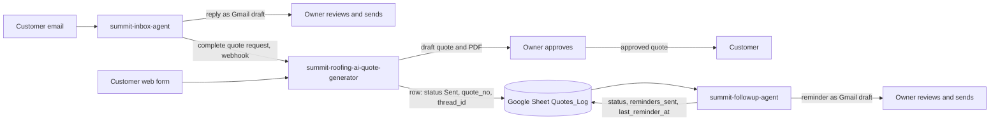

# Summit Roofing AI Back-Office

Three small projects that together automate the back-office of a roofing company: from the first customer email to the follow-up on a sent quote. A human reviews every step that reaches a customer.

> Summit Roofing is a fictional company used for this demo.

## The system

## The three projects

| Project                                                                                            | What it does                                                                                                                                           | Stack                                                 |
| -------------------------------------------------------------------------------------------------- | ------------------------------------------------------------------------------------------------------------------------------------------------------ | ----------------------------------------------------- |
| [summit-inbox-agent](https://github.com/Uzelac97/summit-inbox-agent)                               | Sorts the Summit mailbox into six categories, writes replies as Gmail drafts, flags emergencies, and forwards complete quote requests to the generator | Python, Claude Haiku 4.5, Gmail API                   |
| [summit-roofing-ai-quote-generator](https://github.com/Uzelac97/summit-roofing-ai-quote-generator) | Turns a roof photo and job description into a priced PDF quote, asks the owner for approval, sends the quote to the customer, logs it in the sheet     | n8n, Claude (vision), Gotenberg, Google Sheets, Gmail |
| [summit-followup-agent](https://github.com/Uzelac97/summit-followup-agent)                         | Watches sent quotes, classifies customer replies, updates the sheet, drafts reminders after 3 and 7 days                                               | Python, Claude Haiku 4.5, Gmail API, Sheets API       |

## How they connect

- **Inbox agent to quote generator:** a webhook. The agent posts complete quote requests with a secret in the `X-Summit-Key` header.
- **Quote generator to follow-up agent:** the shared Google Sheet "Summit Roofing - Price List", tab `Quotes_Log`. The generator writes a row with `status`, `quote_no`, the Gmail `thread_id` and `reminders_sent = 0`. The follow-up agent reads those rows, watches the thread, and writes back only `status`, `reminders_sent` and `last_reminder_at`.

## Design principles

- **Humans stay in control.** Replies and reminders are Gmail drafts. A quote reaches the customer only after the owner approves it.
- **Untrusted input is data.** Customer text goes through prompt-injection guards, and the follow-up agent blocks any automatic action when it suspects an injection.
- **Idempotent.** Re-running never creates a second draft or reminder.
- **Minimal permissions.** No code path calls a Gmail send method.

## Author

Milan Uzelac
